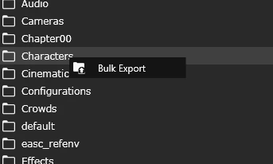
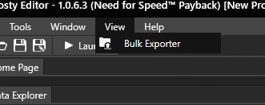
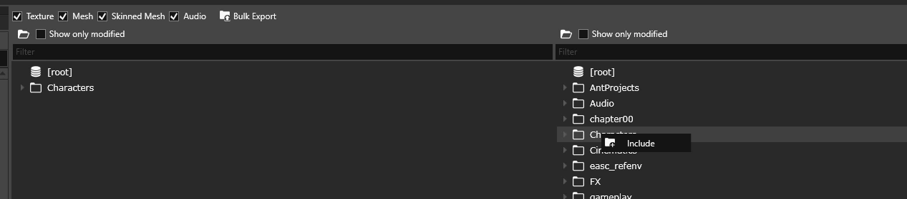
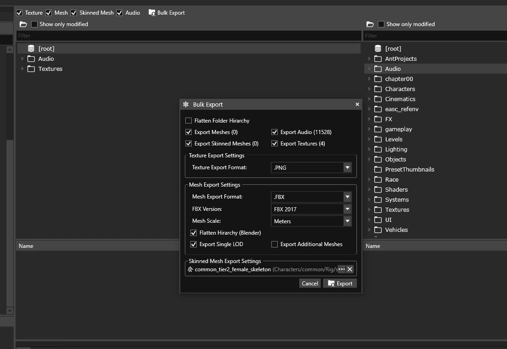

# FrostyBulkExporter

This is a plugin for FrostyEditor which enables bulk exporting of Game assets from Frostbite Engine Games.

This branch runs on [HarGabt's FrostyToolsuite 1.0.7](https://github.com/HarGabt/FrostyToolsuite/tree/1.0.7) (see [README-frosty.md](README-frosty.md)), so it works with the games 1.0.7 supports.

This plugin currently supports exporting of the following assets:

- **Mesh assets**: FBX, OBJ
- **Skinned Mesh assets**: FBX, OBJ
- **Texture assets**: PNG, HDR, TGA, DDS
- **Audio assets**: WAV

**Mesh export settings includes all settings that are currently available in `MeshSetPlugin`.**

## Screenshots:

   
   

   

   

## How to:

There are two ways to bulk export assets:

1. Right clicking on the desired folder in the `DataExplorer` tab on the left side of the `FrostyEditor` and choosing `Bulk Export` option.

2. Opening the `Bulk Exporter` window from the `View` Menu.
   
   2.1. Right clicking the folders or assets from the right panel, and including them to the selection.

   2.2. Clicking the export button on top of the window.

   - You can also right click on the folders and assets on the left selected assets explorer tab and exclude the items from selection.
   - There are asset filtering options on the top of the window that you can use. 

- After these steps the export folder selection window will appear, choose where you want to export the assets.

- Then, the export settings window will appear that lets you choose the asset types to export and the formats and other settings for each asset type.

- Enjoy.

## TODO:

- SVG asset support

## Audio export

- Each track is written as `<asset>_Track #N_<language>.wav` (the language is added when the asset has one). Tracks with more than 2 channels are written as multichannel WAV (`WAVE_FORMAT_EXTENSIBLE`).
- A failing asset is skipped and the export goes on. Everything that needs a look is listed in `bulk_export_skipped.txt` in the export folder:
  - no prefix: the asset could not be exported, or only some of its tracks were (`partial`)
  - `warning:` every track was written, but one looked unusual (worth a listen)
  - `info:` the asset holds no audio (for example music "master" assets), nothing to export
- While exporting, `bulk_export_in_progress.txt` names the asset being processed. If the editor ever closes during an export, that file tells you which asset caused it.
- The native EALayer3 decoder runs in a separate worker process (`EALayer3Host.exe`, extracted to `%TEMP%\FrostyEALayer3Host`), so a crash or hang in it only costs that asset. If an antivirus blocks that file, add an exclusion for that folder.
- To investigate a sound that decodes badly, set the environment variable `FBE_AUDIO_DIAG` to part of its asset name before starting the editor: decode diagnostics for the matching assets are written to `%TEMP%\FrostyAudioDiag`.

## Building

Open `FrostyEditor/FrostyEditor.sln` with Visual Studio 2022 and build `Release - Final | x64` (or `Developer - Debug | x64` to debug). Clone into a path without spaces: the post-build `xcopy` steps of several other plugins (e.g. AtlasTexturePlugin, GuidPlugin) do not quote their paths.
